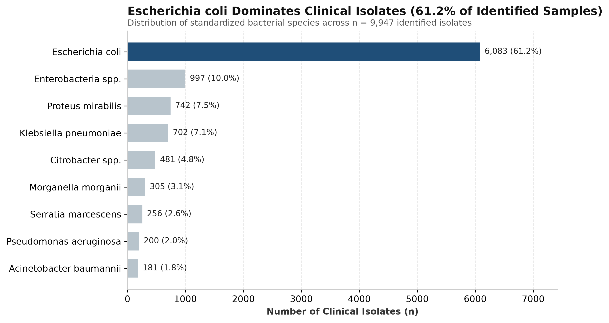
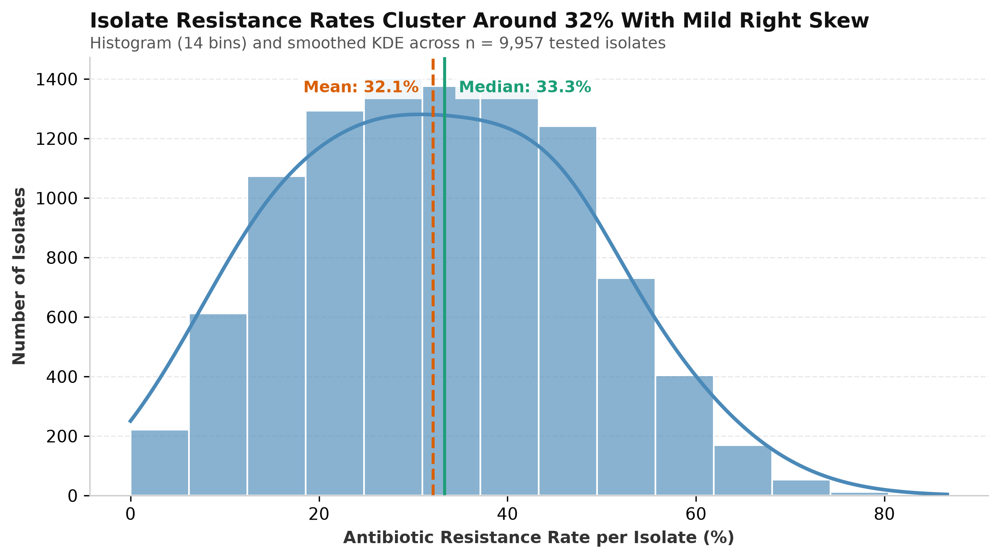
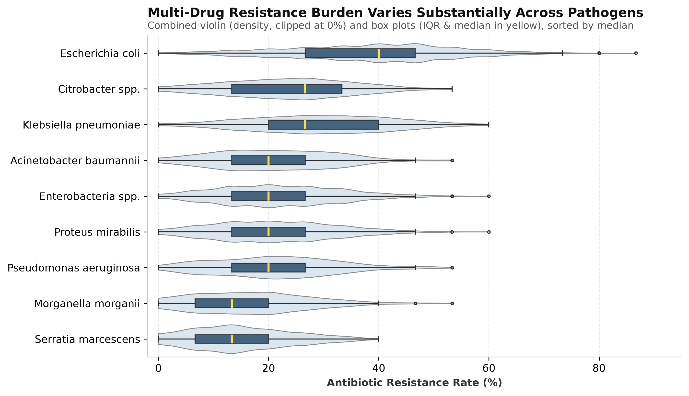
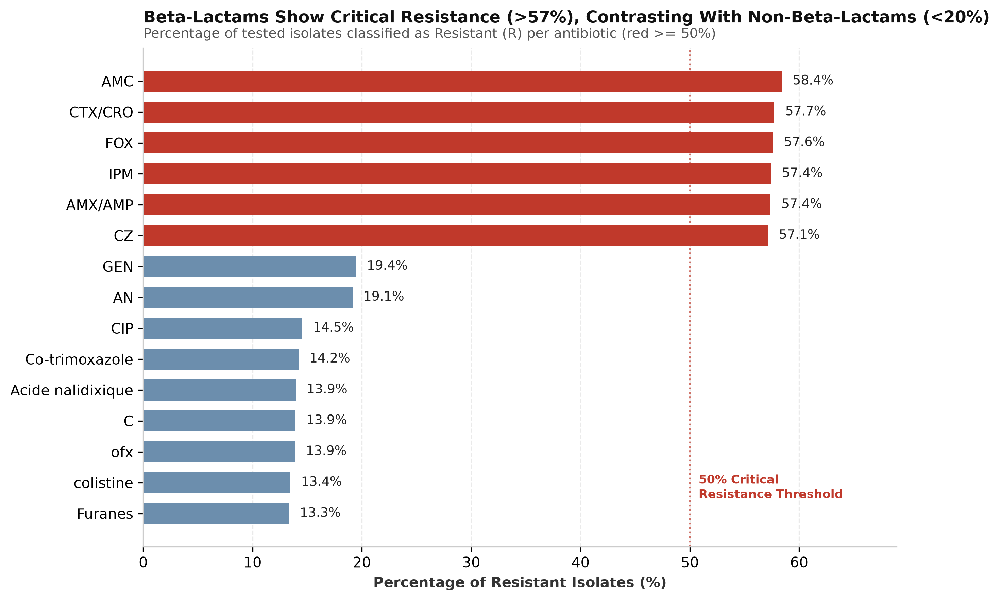
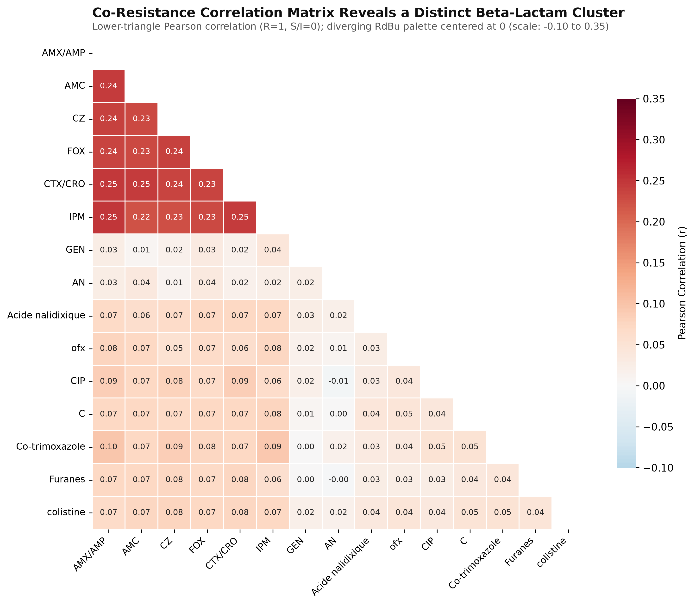

# Visualizing Antimicrobial Resistance: An End-to-End Exploratory Data Analysis

An end-to-end exploratory data analysis (EDA) and visual investigation of **10,710 clinical bacterial isolate records** across 15 antibiotics, developed for the B.Sc. Data Science course *Explorative Data Analysis and Visualization (`DLBDSEDAV01`)* at IU International University of Applied Sciences.

## Key Findings
* **Data Quality & Taxonomic Standardization:** Auditing revealed disguised missingness (`"?"`, `"missing"`), mixed encodings (`True`/`False` vs. `Yes`/`No`), corrupted timestamps, and **10 typographical variants** across four major pathogens (e.g., `E.coi`, `E.cli`, `E. coli`). Consolidating these typos increased *Escherichia coli* prevalence from 48.9% to **61.2%** ($n = 6,083$ of $9,947$ identified isolates).
* **Demographics:** Patient age, infection frequency, diabetes, hypertension, and prior hospitalization all showed **near-zero linear correlation** ($|r| \le 0.013$) with isolate resistance rates—demonstrating that resistance in this cohort is driven by pathogen taxonomy and drug-class co-resistance rather than patient demographics.
* **Pathogen Burden:** *Escherichia coli* carries both the highest isolate volume (61.2%) and the highest multi-drug resistance burden (**40.0% median resistance**), followed by *Citrobacter spp.* and *Klebsiella pneumoniae* (~27% median).
* **Beta-Lactam Co-Resistance Cluster:** A sharp bimodal divide separates **beta-lactam antibiotics** (`AMC`, `CTX/CRO`, `FOX`, `IPM`, `AMX/AMP`, `CZ` — all **>57% resistant**) from **non-beta-lactams** (**<20% resistant**), supported by a distinct intra-class co-resistance correlation block ($r = 0.22\text{–}0.25$).

---

## Visual Highlights

### 1. Pathogen Prevalence

### 2. Isolate Resistance Rate Distribution

### 3. Multi-Drug Resistance Burden by Species

### 4. Drug-Level Resistance Profile (15 Antibiotics)

### 5. Antibiotic Co-Resistance Correlation Matrix

---

## Repository Structure
* `phase1_exploration.py` — Automated structural audit of raw dimensions, duplicates, missingness percentages, and categorical strings.
* `phase2_cleaning_and_stats.py` — PII removal (`Name`, `Email`, `Address`), `age/gender` parsing, regex species extraction, taxonomic typo consolidation, AST standardization, ratio feature engineering (`Resistance_Count`, `Resistance_Rate_Pct`), and descriptive/correlation statistics.
* `phase3_visualizations.py` — Generates all five 300-DPI publication-grade figures applying data-ink ratio optimization, pre-attentive highlighting, and color-blind-safe palettes.
* `cleaned_amr_data.csv` — De-identified, standardized analytical dataset ($n = 9,957$ tested isolates).
* `figures/` — High-resolution PNG exports of Figures 1–5.

## Tech Stack
`Python` • `pandas` • `numpy` • `scipy` • `matplotlib` • `seaborn`

## Data Source
Hosni, A. I. (2024). *Multi-resistance antibiotic susceptibility* [Data set]. Kaggle. https://www.kaggle.com/datasets/adilimadeddinehosni/multi-resistance-antibiotic-susceptibility
